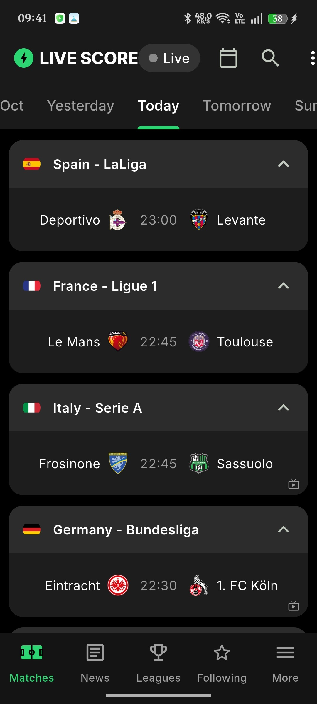
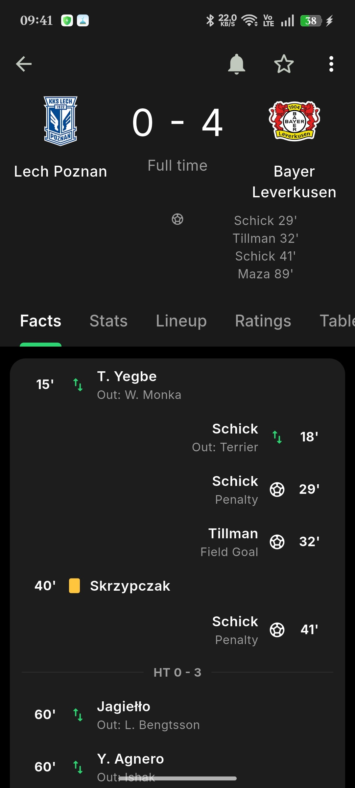
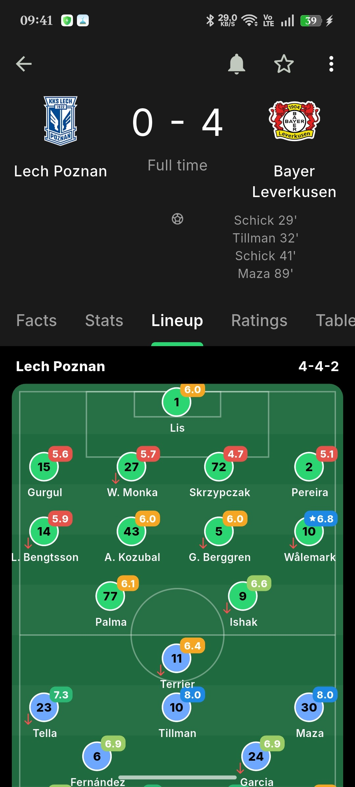
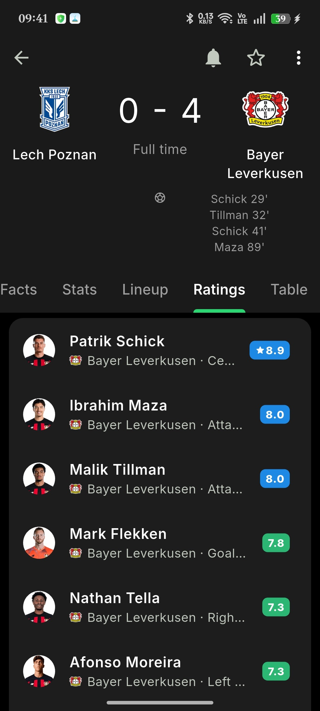
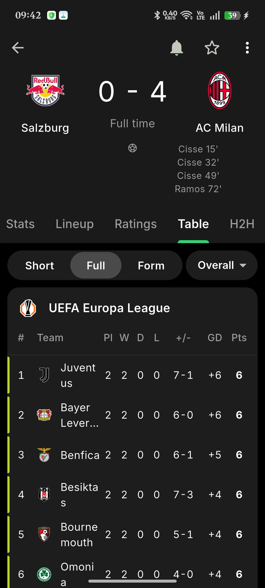

# Live Score App

Live Score is an open-source Flutter football app with 82 stars, built for fast match-day browsing. It brings together live fixtures, today's schedule, standings, lineups, statistics, and match events in a clean cross-platform experience for football fans.

## 📱 App Mockup


## Overview

The app focuses on the information people usually need most during a match day:

- live scores and match status
- today's fixtures across supported competitions
- league tables and standings
- lineups, events, and match statistics
- a mobile-first interface built with Flutter and BLoC

## Features

- Live football fixtures and score updates
- Competition-based browsing for major leagues and tournaments
- Match details including lineups, events, and statistics
- League standings for supported competitions
- Android, iOS, and web support

## Tech Stack

- Flutter
- BLoC / Cubit
- Dio
- GetIt
- Clean architecture-inspired project structure

## Web Support

The mobile apps call `365scores` directly. For Flutter Web, this repository uses a small Cloudflare Worker proxy because the API cannot be called directly from the browser.

Current deployed proxy:

- [https://live-score-proxy-2.radyhaggag50.workers.dev](https://live-score-proxy-2.radyhaggag50.workers.dev)

The Flutter web app is already configured to use that proxy by default. If you ever replace it, you can override the URL with:

```bash
flutter run -d chrome --dart-define=WEB_API_PROXY_BASE_URL=https://your-proxy-url
```

## GitHub Pages Deployment

This repository includes a GitHub Pages workflow at [.github/workflows/deploy_web.yml](/Users/radyhaggag/Programming/Flutter/live_score/.github/workflows/deploy_web.yml:1).

To publish the web app:

1. Push the repository to GitHub on `main` or `master`.
2. In the GitHub repository settings, enable `Pages` and choose `GitHub Actions` as the source.
3. The workflow builds the Flutter web app, adds a single-page-app fallback, and deploys it automatically.

If you later attach a custom domain or host the app at the site root instead of `/<repo-name>/`, update the `--base-href` value in the workflow.

You do not need to add any environment variable for the current setup. The app already points to the deployed Cloudflare proxy by default. The `WEB_API_PROXY_BASE_URL` value is only an optional override for the future if you ever move the proxy to a different URL.

## 📱 Screenshots

Here are some previews of **Live Score App** after the latest update:

<p align="center">
   &nbsp;
   &nbsp;
   &nbsp;
  <br/><br/>
  
   &nbsp;
  
</p>

<p align="center">
   &nbsp;
   &nbsp;
  
  <br/><br/>
   &nbsp;
   &nbsp;
   &nbsp;
  <br/><br/>
   &nbsp;
  
   &nbsp;
  <br/><br/>
  
</p>

## 📥 Download

Get the signed APK from [GitHub Releases](https://github.com/al3nkboot/live_score/releases/latest).

## Screenshots

<p align="center">
  
  
  
  
  
</p>

### Packages used in the project:

- [Dio](https://pub.dev/packages/dio)
- [internet_connection_checker](https://pub.dev/packages/internet_connection_checker)
- [equatable](https://pub.dev/packages/equatable)
- [dartz](https://pub.dev/packages/dartz)
- [bloc](https://pub.dev/packages/bloc)
- [flutter_bloc](https://pub.dev/packages/flutter_bloc)
- [hexcolor](https://pub.dev/packages/hexcolor)
- [get_it](https://pub.dev/packages/get_it)
- [intl](https://pub.dev/packages/intl)

### in the project:

- bloc as State managment
- Clean code
- Clean architecture
- [Restful api](https://www.api-football.com/documentation-v3)
